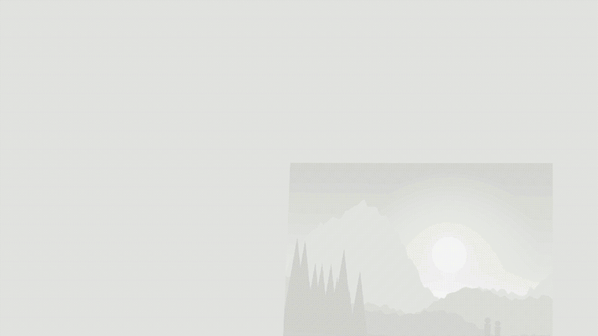

<h1 align="center">Lithophane Studio — turn a photo into a 3D print that glows</h1>

<p align="center">
  <strong>Drop in a picture, get a file your 3D printer can print.</strong><br/>
  Hold it up to a light and the photo appears. Free, runs in your browser, nothing is uploaded.
</p>

<p align="center">
  <a href="https://metiutek.github.io/lithophane-studio/"><strong>▶ Try it now — no sign-up, no install</strong></a>
</p>

<p align="center">
  
  
  
  
  
</p>

<p align="center">
  <br/>
  <sub><a href="docs/promo.mp4">Watch in full quality (MP4)</a></sub>
</p>

---

## What a lithophane is

A lithophane is a thin plate printed at varying thickness — thick where the photo is
dark, thin where it is bright. Sitting on a shelf it looks like a blank white slab. Put
a lamp or a window behind it and the picture appears, in surprising detail.

They make very good gifts, night lights and lamp shades, and they print on any ordinary
FDM printer in white PLA. The only hard part is turning the photo into a printable file.

## What this does

That conversion, in your browser. You give it a JPG, PNG or WEBP; it works out the
thickness map and builds a **watertight** mesh — surface, base and side walls, not just
a bumpy plane — then hands you a binary `.stl` your slicer will accept without asking
you to repair it first.

You see the result in 3D before you export, with a backlit preview that shows roughly
what it will look like once it is printed and lit. Adjust brightness, contrast and
thickness until it looks right, then download.

Flat panel, curved panel, or a full cylinder for a lamp shade.

## Who it is for

- **Anyone with a 3D printer** who wants to make a gift out of a photo and does not want
  to learn Blender to do it.
- **People who would rather not upload family photos** to a stranger's website to get
  an STL back.
- **Anyone who tried a free online generator** and got a mesh full of holes that the
  slicer refused, or a paywall at the download step.

## Why this one

The usual lithophane generators upload your photo to a server, ask you to register, cap
the resolution, or hand back a broken mesh. This one runs inside the page: your photo
never leaves your computer, because there is nowhere for it to go — there is no backend
at all. No account, no limit, no watermark, no cost.

## Features

- **Image to 3D** — JPG / PNG / WEBP, drag & drop anywhere, paste with Ctrl+V, or try the built-in sample
- **3 shapes** — flat panel, curved panel, cylinder lampshade (curved and cylinder are exported standing up, ready to print)
- **Geometry** — width, min/max thickness, frame, curvature, detail level
- **Image adjustments** — brightness, contrast, plus gamma, softness, mirror and invert under *Advanced*
- **Live 3D preview** — orbit, zoom, wireframe, and a **Backlit** view that shows how the print glows
- **Export** — binary `.stl` (closed, outward-facing, print-ready), `.obj`, and a grayscale light-map PNG
- Settings are remembered between visits

## Run it on your computer — 3 steps

The [live demo](https://metiutek.github.io/lithophane-studio/) needs nothing. To run it
locally (works offline, nothing leaves your machine):

**1. Install uv** (it installs Python apps for you). Then **close and reopen the terminal**.

| Windows (PowerShell) | macOS | Linux |
|---|---|---|
| `winget install astral-sh.uv` | `brew install uv` | `curl -LsSf https://astral.sh/uv/install.sh \| sh` |

**2. Install Lithophane Studio**

```bash
uv tool install git+https://github.com/metiutek/lithophane-studio
```

If the terminal says `lithophane` is not recognized, run `uv tool update-shell`, then close
and reopen the terminal.

**3. Open it**

```bash
lithophane
```

It opens in your browser at <http://127.0.0.1:8770>. Press `Ctrl+C` in the terminal to stop.
Options: `--port 9000`, `--no-browser`. Update with `uv tool upgrade lithophane-studio`.

Just want to try it once, without installing? `uvx --from git+https://github.com/metiutek/lithophane-studio lithophane`

### From a clone (for development)

```bash
git clone https://github.com/metiutek/lithophane-studio.git
cd lithophane-studio
python -m lithophane_studio
```

Geometry tests (closed mesh, outward normals, sits on the bed) run with Node, no install:

```bash
node test/mesh.test.mjs
```

## 3D printing settings

| Parameter | Recommended |
|---|---|
| Min thickness | 0.6 mm |
| Max thickness | 3 mm |
| Layer height | 0.1 mm |
| Infill | 100 % |
| Supports | No |

Print flat panels standing upright, on the short edge: the layer lines then run
across the image instead of along it, and the detail survives.

## How it works

- **Three.js** — 3D rendering and preview
- **Canvas API** — image processing and heightmap extraction
- `mesh.js` — pure, DOM-free mesh generation (surface + base + walls, seamless cylinder) and STL/OBJ exporters
- Zero backend, zero dependencies to install, 100 % client-side

## License

MIT — see [LICENSE](LICENSE).

---

made by https://metiu.xyz/
